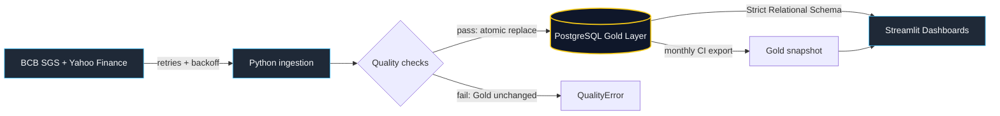
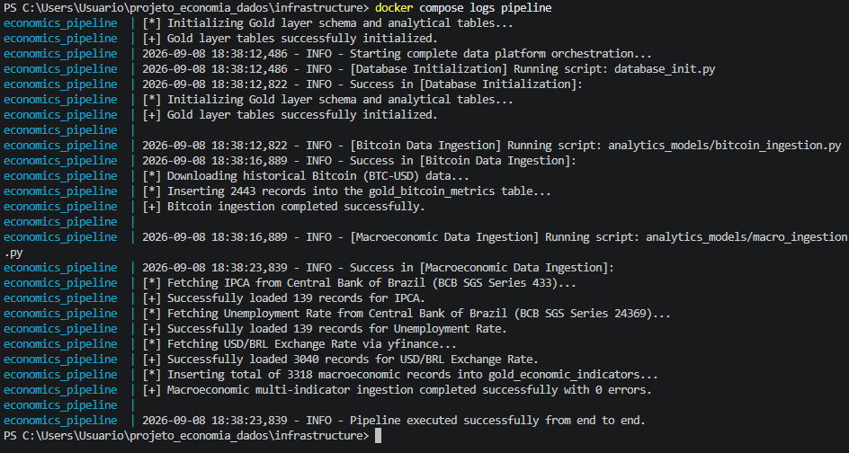
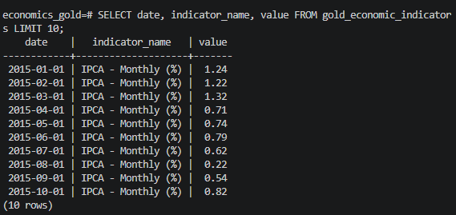
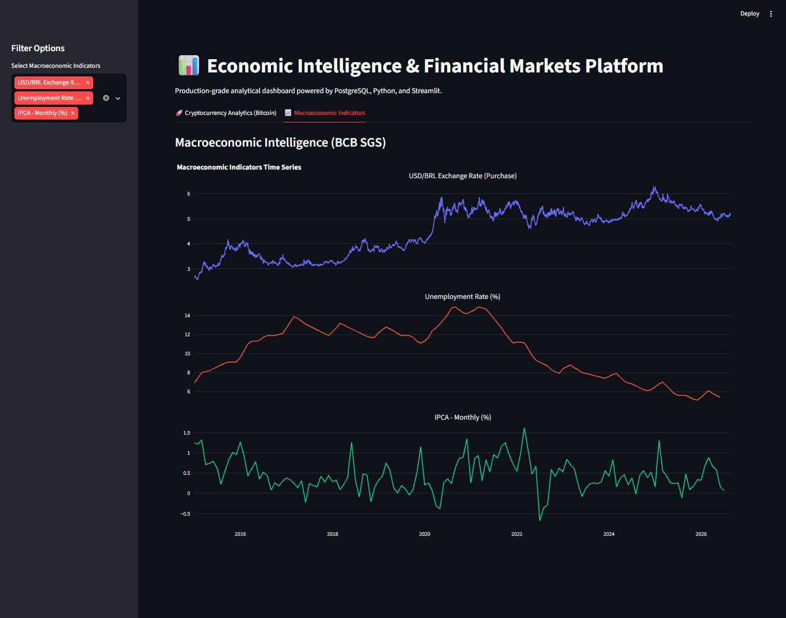
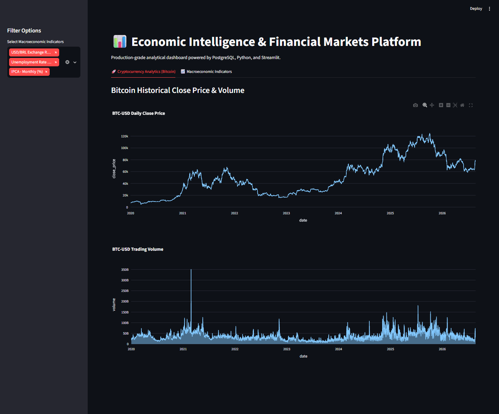
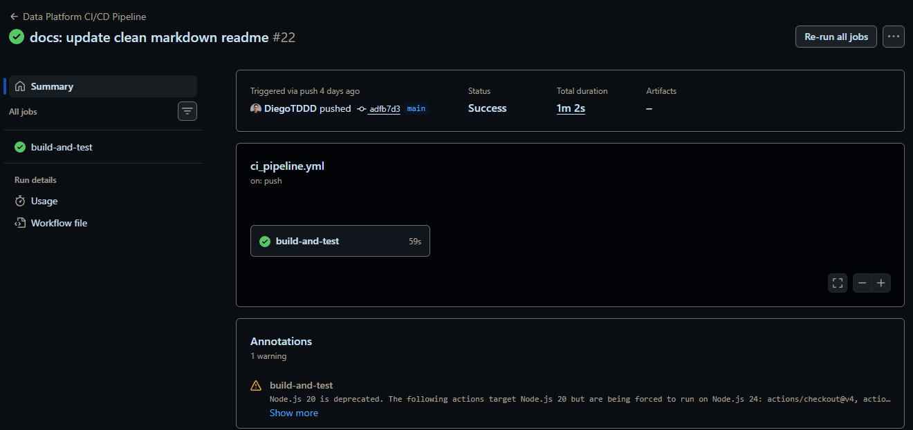

# Economic Intelligence & Financial Markets Platform


**Problem.** Public economic data sources fail in ordinary ways: rate limits, timeouts, empty answers, a format change. A dashboard fed straight from them goes blank or, worse, shows wrong numbers without anyone noticing.

**Solution.** An ELT platform that pulls Brazilian macro indicators (Banco Central do Brasil) and market data (Yahoo Finance) with retries, checks every batch before it may replace the PostgreSQL Gold layer, writes it atomically, and serves it on a Streamlit dashboard.

| Reliability property | How it is guaranteed |
|---|---|
| Gold is never empty or half-written | Delete and insert in one transaction; a test proves a failed insert rolls back the delete on a real PostgreSQL |
| Bad data never reaches the dashboard | Range, null, duplicate, future-date and row-count checks on every batch; a failing batch is rejected and Gold keeps its previous data |
| Brief outages recover by themselves | Exponential backoff per HTTP call (2/4/8 s, only 429/5xx/timeouts) and 3 attempts per pipeline step |
| One source down does not erase its history | Per-indicator replace: a missing indicator keeps its previous rows |
| Duplicates are impossible | Unique indexes on `(date, indicator)` and `(date)` |

**🔗 Live dashboard:** [diegotddd-economic-data-platform.streamlit.app](https://diegotddd-economic-data-platform.streamlit.app) (reads the Gold snapshot that CI refreshes monthly from the live sources) · **Design decisions:** [`docs/adr/`](docs/adr/README.md)

📄 **[Read the Full Engineering Case Study (PDF)](./manuscript/Economic_Platform_Case_Study.pdf)**

---

## 🏛️ Project Architecture & Pipeline Flow

The platform is built as a modular, containerized ELT pipeline. It separates extraction, transactional storage, orchestration, and presentation into isolated layers to guarantee reproducibility and data integrity.



## 🚀 Demonstration & Visual Evidence

**Ingestion & Orchestration Logs**
Modular extraction scripts fetch, validate, and normalize raw JSON payloads into clean DataFrames before inserting them into the database.



**PostgreSQL Gold Layer**
Enforcing schema-on-write with ACID guarantees, ensuring analytical queries run on clean, normalized time-series data.



**Macroeconomic Dashboard**
Interactive Streamlit dashboard tracking USD/BRL exchange rate, unemployment, and IPCA inflation — powered by optimized SQL queries directly from the Gold layer.



**Cryptocurrency Dashboard**
Historical BTC-USD close price and trading volume, sourced via yfinance and served from the same Gold layer.



**CI/CD Automation (GitHub Actions)**
Automated build-and-test pipeline validating code quality on every push.



## 🛠️ Tech Stack & Components

| Layer | Component | Purpose |
|---|---|---|
| Ingestion | Python (requests, pandas) | API data extraction, JSON parsing, and type enforcement. |
| Storage | PostgreSQL | ACID-compliant relational storage for clean time-series metrics. |
| Orchestration | Python (orchestrator.py) | Execution sequencing, automatic retries for transient failures, and fail-fast on persistent errors. |
| Infrastructure | Docker & Docker Compose | Network isolation, health-check-based startup ordering, and environment-agnostic reproducibility. |
| CI/CD | GitHub Actions | Automated build and test pipeline on every repository push. |
| Presentation | Streamlit & Plotly | Interactive operations console and real-time visualization. |

## ⚙️ Run Locally

**Prerequisites**
* Docker Desktop
* Git

**1. Clone the repository**
```bash
git clone https://github.com/DiegoTDDD/Economic-data-platform.git
cd Economic-data-platform
```

**2. Start the environment**
```bash
cd infrastructure
cp .env.example .env      # then open .env and set DB_PASSWORD
docker compose up -d --build
```
> The containers will not start without `DB_PASSWORD`: create `infrastructure/.env` from the example and choose your own password first. Ports can also be changed in that file.

> **Ran this stack before?** The database volume keeps the password it was first created with, so the containers fail with `password authentication failed`. Reset it once with `docker compose down -v` and start again (the pipeline reloads the data).

**3. Check the containers**
```bash
docker compose ps
```
> The first start takes a few minutes: the dashboard only starts after the `pipeline` container finishes loading the data. That container shows as `Exited (0)` when it is done, which is expected.

**4. Open the dashboard**
Open your browser and navigate to `http://localhost:8501`.

**5. Stop the environment**
```bash
docker compose down
```

## 🧪 Tests

```bash
pip install -r requirements-test.txt
pytest          # PostgreSQL tests run when DB_PASSWORD (and DB_HOST/DB_PORT) point at a database
```

23 tests: parsing recorded BCB and Yahoo payloads (including the MultiIndex columns of newer yfinance), the retry rules and their exact waits, every quality check, the orchestrator's step retries, and four tests against a real PostgreSQL (replace, rejected batch, rolled-back insert, missing source keeps its history).

## 🔒 Automated Checks

- **CI** (`ci_pipeline.yml`) runs on every push and pull request: `ruff` (type hints required, no `print` in pipeline code), all 23 tests against a PostgreSQL service, a render of the dashboard from the snapshot, and a Docker build.
- **Refresh snapshot** (`refresh-snapshot.yml`) runs the real pipeline against the live sources every month on a fresh database, exports the Gold tables to `data/gold_snapshot/` for the public dashboard, and commits them only if every step and check passed.
- **App health** (`app-health.yml`) opens the [live app](https://diegotddd-economic-data-platform.streamlit.app) in a real browser after each push and once a day (waking it if it was asleep) and fails if the app shows an error.
- **Security audit** (`security-audit.yml`) audits `requirements.txt` with `pip-audit` whenever dependencies change and every Monday. It fails only when a vulnerable package has a fixed version available.

## ⚠️ Limitations

- **Full refresh each run.** Each run reloads the whole history: fine for a few thousand rows, but large series would need incremental loads.
- **Time-based scheduling only.** Runs come from Docker Compose or the monthly workflow, with no event triggers or backfills (Airflow or Dagster would add those).
- **Yahoo Finance is an unofficial API.** It is the most likely source to break, which is why it has retries and why a failure there does not erase history.

## 📊 Data Sources

* **Banco Central do Brasil (BCB SGS):** IPCA inflation index (Series 433) and Unemployment Rate (Series 24369).
* **yfinance API:** USD/BRL exchange rate and historical Bitcoin (BTC-USD) market prices.

*Note: Raw data is dynamically extracted via APIs; no static datasets are hardcoded in the repository.*